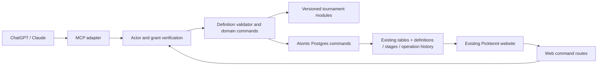

# Architecture, storage and API contracts

Contract version 1.0 · Implements PRD.md version 3.0 · Proposed names must be reconciled against the authoritative schema in T00.

## 1. Application shape



Use the installed project stack and lockfile. Read its AGENTS.md and installed Next.js documentation. Add only the schema-validation/test/MCP dependencies needed by the chosen implementation; pin them through the existing package manager. Do not upgrade the framework as part of this feature.

Canonical new source directory: `lib/tournament-builder/`. Existing `lib/tournament/` algorithms are inputs to adapters; legacy callers retain their current policy until explicitly routed to modular_v1.

The module catalog is application code, not editable database code. A published tournament pins schema and module versions. One deployed application executes all tournament definitions; no n8n installation or per-event server is required.

## 2. Canonical definition

See `examples/tournament-definition.json`. Top-level keys are `schema_version`, `event`, `registration`, `policies`, `scheduling`, `nodes`; reject unknown keys. Resource IDs, ownership, approvals, hashes, grants, accepted results and database revisions are supplied by the server, never accepted inside this manifest.

| Section | Contract |
|---|---|
| event | name 1–120 trimmed characters; ISO starts_at and expected_end_at with end after start; IANA timezone consistent with their offsets; venue_name 1–200; visibility public/unlisted; courts integer 1–8 |
| registration | mode open/approval; entry_type singles/fixed_doubles; min_entries/max_entries integers 2–16 with min≤max; closes_at≤starts_at and in the future at publication; partner_consent true for doubles, false for singles; organizer_plays boolean |
| policies.match | version 1; games 1; target 11/15/21; win_by 1/2; cap null; scoring side_out/rally |
| policies.ranking | version 1; order unique, first wins_desc followed by supported secondary keys; final_tie recorded_draw |
| policies | confirmation opponent_or_admin_v1; withdrawal stage_sensitive_v1; correction impact_review_void_and_replay_v1 |
| scheduling | estimated_slot_minutes integer 5–120; minimum_rest_minutes integer 0–30 and less than slot; contingency_minutes integer 0–240 |
| nodes | 4–7 objects; unique id 1–40 [a-zA-Z0-9_-]; known module version; from points to exactly preceding compatible node; config only declared module fields |

`expected_end_at` is a desired venue window. Preview compares it to the estimate and returns a warning if insufficient. It does not promise untimed matches will finish by that timestamp. A structurally invalid format is a blocking error; uncertain duration is a disclosed warning.

For direct elimination, capacity need not promise the final roster; at lock the actual count must be a supported bracket size. Capacity and min-entry settings that make every possible accepted count invalid fail validation. Qualification count must be achievable and validated again against actual eligible entries.

The draft may be incomplete. `createDraft` saves partial definition data, while `validateDraft` returns missing fields. Publication requires the complete strict schema and acknowledged current warnings. Never invent missing dates, partners or tie policies from chat text.

## 3. API results and errors

Mutation request envelope:

```json
{
  "operation_id": "b27c31ec-0c66-4bf6-94c4-708432cd11a0",
  "expected_revision": 7,
  "data": {"match_id": "a43c4c86-d356-4ea1-bd9a-8456a8e27b02", "score_a": 11, "score_b": 9}
}
```

This is a submitScore envelope with illustrative UUIDs. The client generates a UUID once and reuses it on retries. `expected_revision` is omitted only for creating a new draft. Routes carry the tournament ID separately. Canonical request hashing includes command, resource, expected revision and normalized data; excludes transient transport headers. Store a sanitized request sufficient to explain/replay the domain change without credentials.

Successful response: `operation_id`, `tournament_id`, `revision`, `status`, and command-specific `data`. An error has `code`, `message`, optional `field_path`/`node_id`, and safe `details`. Validation adds `valid`, `errors`, `warnings`, `missing_fields` and `draft_revision`. A conflict does not partially mutate the event.

| Code | Meaning |
|---|---|
| UNAUTHENTICATED / FORBIDDEN | No valid actor or insufficient event/grant permission |
| GRANT_REVOKED | Connector authorization no longer active |
| NOT_FOUND | Missing or undisclosable resource |
| INVALID_DEFINITION / MISSING_FIELDS | Unsupported graph/configuration or incomplete draft |
| INVALID_ADVANCEMENT / INVALID_SCORE | Unsupported qualifier count or illegal completed score |
| INVALID_STATE / PUBLISHED_DEFINITION | Command not allowed in current lifecycle |
| STALE_REVISION / STALE_PREVIEW | Concurrent change invalidates edit/computation |
| IDEMPOTENCY_CONFLICT | Same operation ID reused with a different command/body |
| CAPACITY_FULL / REGISTRATION_CLOSED | Admission cannot succeed |
| DUPLICATE_ENTRY / INCOMPLETE_ROSTER | Membership or consent violates entry invariants |
| UNRESOLVED_TIE / UNRESOLVED_DISPUTE | Qualification/result blocked |
| COURT_BUSY / PLAYER_BUSY / REST_REQUIRED | Match cannot start yet |
| DOWNSTREAM_STARTED | Correction requires explicit void-and-replay |

`getOperation` resolves a timeout's unknown outcome using the original ID. Never automatically generate a fresh ID after an ambiguous network response.

Error taxonomy: INVALID_DEFINITION and MISSING_FIELDS are command-level envelope codes. Individual `errors`/`missing_fields` issues use MISSING_FIELD, UNSUPPORTED_MODULE, UNSUPPORTED_RULE, INCOMPATIBLE_CONNECTION, INVALID_CAPACITY, INVALID_ADVANCEMENT or RESOURCE_CONFLICT, with a field/node path. Do not use singular and plural missing-field codes interchangeably at the same level.

## 4. Command catalog and authority

All mutation names below use the envelope above. Data fields shown are additional to resource ID/revision. The implementation must expose a narrow allowlist, not arbitrary database operations.

| Command | Data / result | Authorized caller |
|---|---|---|
| createDraft | partial definition → new ID/revision/missing fields | Signed-in web user or delegated creator |
| updateDraft | replacement partial definition → revision/issues | Owner/admin; delegated unpublished draft permission |
| validateDraft | no mutation → issues at revision | Same authorized draft readers |
| previewTournament | no mutation → rules/graph/counts/warnings at revision | Same authorized draft readers |
| publishTournament | reviewed revision, reviewed_definition_hash, acknowledged warning codes → published definition hash | Owner, website |
| requestEntry | own intent, optional invited partner identity → entry state | Player, website |
| acceptPartner | invitation/entry ID and definition consent → entry state | Invited player, website |
| approveEntry / rejectEntry | entry ID and reason when rejecting | Owner/admin |
| cancelEntry | own entry ID before lock → cancelled | Participant in entry |
| closeRegistration / reopenRegistration | state transition before roster lock | Owner/admin |
| lockRoster | reviewed roster revision → roster hash + schedule generation | Owner/admin |
| startTournament | ready event → active | Owner/admin |
| startMatch | match ID → in_progress and assigned court claim | Own match participant or owner/admin |
| submitScore | match ID, score_a/score_b → provisional result | Own match participant; admin submission |
| confirmScore | match ID and submitted result revision → accepted result | Opposite entry or explicit admin attestation |
| attestScore / adjudicateDispute | match ID, chosen legal scores/outcome, reason → accepted outcome | Owner/admin |
| disputeScore | match ID, result revision, short reason → disputed | Either entry or owner/admin |
| resolveTie | stage ID, tied entry IDs, input revision → recorded draw | Owner/admin |
| previewCorrection | source match/new legal outcome → affected chain + preview hash | Owner/admin |
| commitCorrection | preview hash, revision, reason, resolution ordinary/void_and_replay | Owner/admin |
| previewWithdrawal / withdrawEntry | entry ID/reason → impact; then preview hash/revision → withdrawal | Owner/admin after lock; own cancellation before lock |
| reopenResults | completed event, reason → active/placements under review | Owner |
| cancelTournament | reason → cancelled/no winner | Owner |
| getOperation | own authorized operation ID → safe receipt | Original actor with current permission |

Logistical court changes use an admin command limited to unstarted fixtures with conflict validation. Existing admin-add/remove routes must enforce owner policy and retain at least one owner for modular events. This is adaptation of existing administration, not a new role system.

## 5. Atomic execution and algorithm reuse

1. Verify credentials and current event/grant authorization. Parse the command's strict schema.
2. Look for the same actor/client/operation receipt. Return it only after current authentication/event access/action permission and grant checks; a different request hash is IDEMPOTENCY_CONFLICT. A later deadline, publication or completion does not invalidate an already committed accessible receipt. Lifecycle guards apply to new execution, not to reading that historical result.
3. Read a bounded event snapshot at revision N, including pinned definition, roster, stages and relevant results.
4. Compute the deterministic effects with trusted TypeScript modules. Draws use server-generated randomness and become accepted once only; the stored result, not a fresh draw, is used after retries.
5. Call a narrow server-only Postgres command. In one transaction, recheck actor permissions/grant, lock the tournament and operation identity, repeat receipt lookup, then for a new operation compare revision N, check current lifecycle, enforce event/fixture relationships, and persist the outcome plus dependent changes, audit history and receipt.
6. Increment revision exactly once for this accepted command. Commit before reporting success. If any check fails, roll back everything. Concurrent losers re-read; do not silently apply stale effects.

Do not expose a generic client-writable effects JSON endpoint. Effects plans can be produced only inside trusted server code. Database functions accepting them are callable only by the server role, with public/anon/authenticated execution revoked and a fixed search_path. Actor identity comes from verified session/token claims supplied by that server, never from request data. Prefer a narrowly privileged role; if the existing server-only service client is reused, restrict its usage to these reviewed functions. Never expose that credential to either browser or assistant.

This design reuses existing TypeScript algorithms without requiring a duplicate tournament engine in SQL. SQL still enforces authorization, revision, uniqueness, lifecycle and referential constraints. Review the server/database trust boundary in T03 and T08.

The bounded runtime updates standings/qualification/assignments/placements during the same successful command. No asynchronous accepted result may be left without a recoverable progression record. Since no work is acknowledged until the complete transaction commits, a crash either leaves the previous state or the complete new state. A crash after commit is resolved through the receipt.

Persist logical fixture identities so duplicates are impossible. Updating the page is not a prerequisite for progression. Commands must not call an LLM. If measured transaction sizes fail at the supported 16-entry limit, escalate the design with evidence before adding a worker; never quietly weaken atomicity.

## 6. Existing versus new storage

| Area | Additions / invariant |
|---|---|
| tournaments | engine_version (legacy default, modular_v1 explicit), modular_state, revision, definition_id, roster_revision, timezone, registration_closed_at, result_version, results_under_review, completion/cancellation timestamps |
| teams | entry_state, consent/eligibility version, seed or seed-order reference, withdrawal metadata; same event identity |
| team_members | consented_definition_id, consented_at, membership status; every active player belongs to at most one active entry per tournament |
| tournament_players | Keep per-profile event membership/status as compatibility projection; update in the same transaction as entry admission |
| rounds | stage_id, schedule_generation, logical wave number, current/archived marker |
| matches | stage_id, fixture_key, schedule_generation, revision, outcome_kind, winning_entry_id, submitted_entry_id, result_revision, started_at/ended_at, void/exclusion metadata |
| standings | stage reference, input revision, eligibility and tie group data; projection reproducible from accepted outcomes; replace/update atomically |
| tournament_definitions | id, tournament_id, schema_version, revision, JSON definition, status draft/published, canonical hash, actor/approval metadata; published row immutable |
| tournament_stages | tournament/definition/node/module identity, state, input/output revisions and bounded output snapshot, blocked code; one current row per node and definition |
| tournament_operations | operation UUID + actor/client scope, request hash, tournament, command, safe request/result, prior/new revision, before/after domain facts, reason, created_at; append-only for ordinary actors |
| connection_grants | Provider/client binding, user, application permission set, active/revoked state where native authorization storage alone does not express/revoke app permissions |

Use a separate protected result-history table only if actual volume/query needs make operation history insufficient; record the reason before adding it. Result history must remain queryable by match and may not be discarded with a fixture generation. Store no OAuth secrets, passwords or raw AI conversations in operations/history.

Actual migration DDL is produced after inspecting deployed triggers/constraints. Do not guess its sequence number or assume the locally untracked 013 migration is applied. Avoid duplicate owner insertion when the existing handle_new_tournament trigger already creates it.

Database constraints/guards:

- Composite event relationships prevent matches, rounds, teams or dependencies from crossing tournaments.
- Unique current logical fixture per tournament/stage/generation prevents duplicate scheduling.
- Atomic admission plus a database guard prevents two active team memberships for one player in one event; a plain uniqueness constraint on (team_id,user_id) is insufficient.
- Published definitions and accepted history cannot be edited/deleted by ordinary API clients.
- The current globally unique tournament-name constraint requires review: remove global uniqueness for modular names if safe for legacy consumers; preserve ID/join-code uniqueness. Test two owners using the same event name.
- Multi-row writes to roster, membership projections, results and operations commit together.

## 7. Compatibility mapping and write guards

Keep `tournaments.status` as an atomic legacy-facing projection:

| modular_state | status projection |
|---|---|
| draft | draft |
| registration_open / registration_closed / ready | registration |
| active, no playoff phase active yet | active |
| active, playoff phase active | finals |
| completed | completed |
| cancelled | cancelled; extend the existing status check/type and labels to recognize it |

Inventory all legacy readers, statistics and DUPR routes when adding cancelled; exclude cancelled, void, non-played and unaccepted outcomes where appropriate. Existing status values retain their meaning. Route callers that need modular outcome semantics to the modular read model. Never display a cancelled event as successfully completed.

Existing match statuses remain `scheduled`, `in_progress`, `score_entered`, `disputed`, `validated`, `walkover` for compatibility. `outcome_kind` is authoritative for played/retirement/walkover/no_contest. Use validated for terminal retirement/no_contest with explicit outcome fields; a no-contest has no winning entry or point contribution. New reads never infer winner merely from score_a ≥ score_b. Void outcomes are excluded through an explicit current/void marker with preserved history.

New routes resolve engine version once and call the corresponding policy. For modular events, block old direct table writes and existing broad elevated routes that would bypass commands. An application-side if statement alone is insufficient: inspect all RLS policies (permissive policies combine), function grants, triggers and server-role writers. Add modular-event guards while proving legacy behavior still works. Keep Auth/profile operations outside this tournament write guard.

## 8. MCP and consent

Implement one hosted MCP adapter using a maintained SDK compatible with both clients. Authentication must support the verified OAuth discovery, authorization-code/PKCE and client registration behavior. Reuse Supabase Auth if its actual project capabilities meet those needs. Website sign-in remains its existing flow; connector consent authorizes specific app actions.

Tools: `get_capabilities`, `list_modules`, `create_draft`, `get_draft`, `update_draft`, `validate_draft`, `preview_tournament`, `get_review_link`, `get_operation`. Map them to the same services above. Grant draft access scoped to the verified user; no score, registration, role, publication or cancellation tool in this MVP. Published events reject draft mutation.

Validate issuer, signature, audience/resource, expiry and client/grant binding. A token for another service is not valid just because it is signed. Record and enforce revocation on the next request, including cached receipts. RLS alone does not replace these action-level grants. Redact tokens and private contact fields in logs and responses.

Test actual ChatGPT and Claude accounts in T01/T08; account eligibility cannot be proven with a mocked MCP client. Current provider guides were verified during the preceding assessment; recheck at implementation because account/UI policies may change:

- https://supabase.com/docs/guides/auth/oauth-server/mcp-authentication
- https://developers.openai.com/api/docs/guides/custom-mcp-server
- https://help.openai.com/en/articles/12584461-connecting-custom-mcp-servers-in-chatgpt
- https://support.claude.com/en/articles/11175166-get-started-with-custom-connectors-using-remote-mcp

## 9. File map

| Proposed path under verified application root | Responsibility |
|---|---|
| lib/tournament-builder/definition.ts | Types/strict definition schema and draft shape |
| lib/tournament-builder/types.ts | Shared execution snapshot, module output and command effect types |
| lib/tournament-builder/catalog.ts | Module descriptors, allowed patterns and questions |
| lib/tournament-builder/validate.ts | Graph/configuration validation and field errors |
| lib/tournament-builder/policies.ts | Score legality, ranking configuration, exceptional-outcome rules |
| lib/tournament-builder/modules/*.ts | Seven module adapters and pure computation |
| lib/tournament-builder/runtime.ts | Bounded evaluation of the seven supported nodes into one effects plan |
| lib/tournament-builder/commands.ts | Authorized command service and effect planning |
| lib/tournament-builder/repository.ts | Snapshot reads and narrow atomic RPC calls |
| lib/tournament-builder/access.ts | Verified actor, event roles and delegated grants |
| lib/tournament-builder/corrections.ts | Dependency impact and revision-bound resolution |
| lib/tournament-builder/mcp.ts | Tool registration and translation; no duplicate rules |
| app/api/tournament-builder/drafts/route.ts | Create draft |
| app/api/tournament-builder/[id]/route.ts | Authorized draft/read model |
| app/api/tournament-builder/[id]/commands/route.ts | Web command allowlist and validated dispatch |
| app/api/mcp/route.ts | MCP transport, bounded requests and auth |
| app/(app)/tournaments/[id]/review/page.tsx | Owner review and publication |
| components/tournament/builder-*.tsx | Existing-style review, progress and intervention UI |
| tests/tournament-builder/*.test.ts | Pure contract/algorithm tests |
| tests/tournament-builder/*.integration.test.ts | Real Postgres roles, transactions and retries |
| tests/e2e/tournament-builder.spec.ts | Browser journeys |

A path can be combined with an existing equivalent when T00 confirms it; record the mapping, do not create parallel competing APIs merely to match a filename. Existing source paths to adapt are listed in the reuse plan and task cards.

## 10. Migration and release

Use an isolated checkout of the verified deployed baseline with necessary shared changes explicitly reconciled. Additive migrations default existing rows to legacy, retain IDs and links, and do not fabricate historical definitions. Run schema/RLS tests with ordinary users, not only an elevated connection.

Rehearse against representative sanitized data. Verify row counts, owner membership, consent, fixture/result integrity and unchanged session RPC contracts. Test rollback behavior at the application level: disable new modular creation, retain compatible read/operation support for existing modular events, and stop affected writes if needed. Do not drop new tables or reinterpret modular events as legacy to roll back.

Only the coordinator integrates schema and shared API changes. Production application requires authorization for the exact migration and deployment. Record the final URL/commit/schema evidence separately from local build and staging results.
